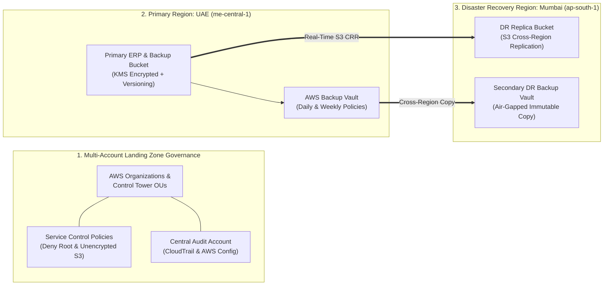

# AWS Enterprise Landing Zone Governance & Multi-Region DR (Terraform)
[](https://github.com/shivakokilan/aws-landing-zone-dr-terraform/actions/workflows/terraform-validate.yml)
Production-ready Infrastructure as Code (IaC) template implementing multi-account **AWS Control Tower & Organizations governance guardrails**, centralized **AWS CloudTrail & Config compliance auditing**, and **Cross-Region Disaster Recovery (S3 CRR + AWS Backup)** between UAE (`me-central-1`) and Mumbai (`ap-south-1`).

## Governance & Cross-Region DR Architecture



## Key Enterprise Capabilities
- **Multi-Account Guardrails (SCPs):** Enforces preventive Service Control Policies blocking public S3 buckets, disabling root user API keys, and restricting deployments to approved regions.
- **Cross-Region Disaster Recovery (RPO < 15 mins):** Configures **S3 Cross-Region Replication (CRR)** with KMS envelope encryption from `me-central-1` (Dubai) to `ap-south-1` (Mumbai) for regional business continuity.
- **Automated FinOps Tiering:** Transitions replicated DR objects automatically to **S3 Glacier Instant Retrieval** after 30 days, cutting cross-border DR storage spend by over 40%.
- **Centralized Compliance & Audit Trail:** Aggregates multi-account CloudTrail logs with log-file validation enabled to meet GCC financial and healthcare audit standards.

## Quick Start

```bash
# 1. Initialize Terraform providers (Primary + DR region aliases)
terraform init

# 2. Preview Landing Zone guardrails and S3 CRR disaster recovery
terraform plan -var="org_prefix=enterprise-gcc"

# 3. Provision governance and DR resources
terraform apply -auto-approve
```
